# Synthetic figure gallery / 合成数据效果样张

These are original, reproducible teaching examples, not contest results or copied
paper figures. Every preview carries a synthetic-data label. Quantities have
arbitrary units unless explicitly defined. Do not reuse these values in a paper.

The [20 base preset cards](../references/presets.md) provide broader task-specific
prompts; these six examples demonstrate a subset. All twenty-six
[advanced presets](../references/presets-advanced.md) have previews in the
[second gallery](#advanced-gallery--进阶样张) below. The [original demo script](../scripts/render_examples.py)
generates both PNG and vector PDF with NumPy and Matplotlib and never executes
the downloaded reference code.

## F01 · Evidence mosaic / 多面板


[Vector PDF](f01-mosaic.pdf). Forty-eight synthetic observations follow
`8 + 0.45t + 1.5 sin(t/2)` plus independent Normal(0, 0.6²) noise. The linear
reference is `8 + 0.45t`. Panels show the observations and known generating mean,
descriptive mean absolute errors, and residuals about that mean. Neither curve
was estimated from data; the error comparison is not held-out model validation.

## F02 · Predictive intervals / 预测区间


[Vector PDF](f02-forecast.pdf). The known mean is `3 + 0.5t + 0.8 sin(t/2)` with
independent Gaussian noise of standard deviation `0.4 + 0.035t`. After the
illustrative boundary t=8, bands show exact 50% and 95% pointwise predictive
intervals under that known model. They represent future observation noise,
exclude parameter uncertainty and do not provide simultaneous path coverage.
This is a design example, not a fitted empirical forecast.

## F03 · Raincloud / 雨云图

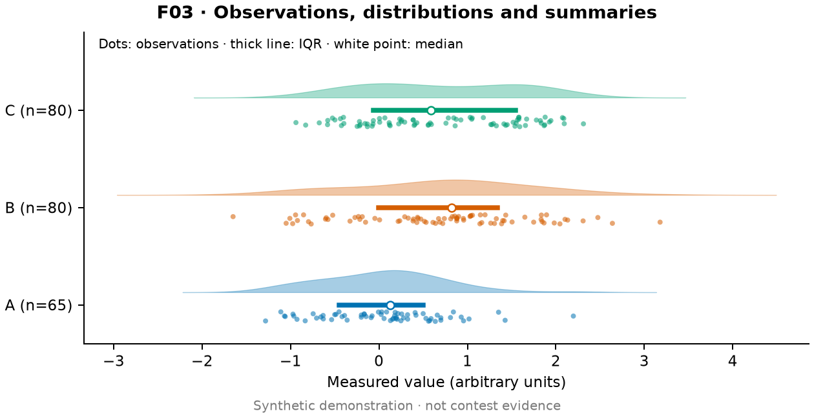

[Vector PDF](f03-raincloud.pdf). Independent synthetic groups contain 65, 80 and
80 observations. Group C is a two-component Gaussian mixture. Dots retain the
observations with vertical jitter; clouds use Gaussian KDE with bandwidth
`1.06 × sample_SD × n^(−1/5)` and a common density-height multiplier. Thick lines
show sample IQR and white points the median, not confidence intervals. Equal
cloud area represents normalized density, not equal group sample sizes.

## F10 · Pareto tradeoffs / Pareto 权衡

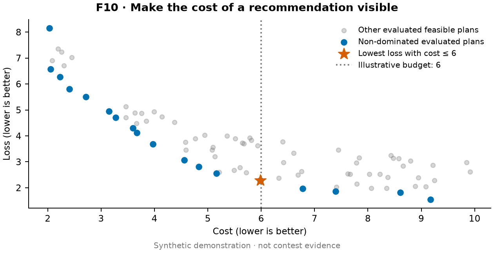

[Vector PDF](f10-pareto.pdf). Eighty synthetic feasible plans have cost drawn
uniformly from [2,10] and loss `13/cost + Uniform(0,1.8)`. Both objectives are
minimized. Blue marks are non-dominated among these evaluated points. The star
minimizes loss subject to an explicitly illustrative cost budget of 6. No claim
of a continuous global frontier or universal best plan is made.

## F16 · Global sensitivity / 全局敏感性

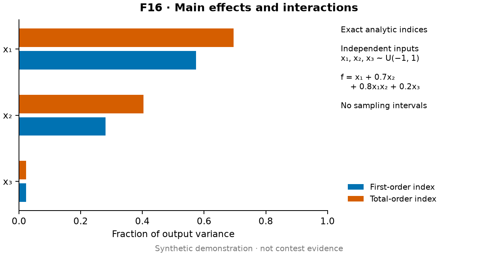

[Vector PDF](f16-sensitivity.pdf). For independent xi ~ Uniform(−1,1), the synthetic
model is `f = x1 + 0.7x2 + 0.8x1x2 + 0.2x3`. Exact variance components are
`V1=1/3`, `V2=0.49/3`, `V3=0.04/3`, `V12=0.64/9`; total variance is their sum.
First-order indices divide each main component by total variance; total-order
indices also include the interaction for x1 and x2. The plotted indices are
analytic, not estimated, so no confidence intervals are invented. Total-order
indices are not normalized to sum to one.

## F20 · Scenario robustness / 情景稳健性

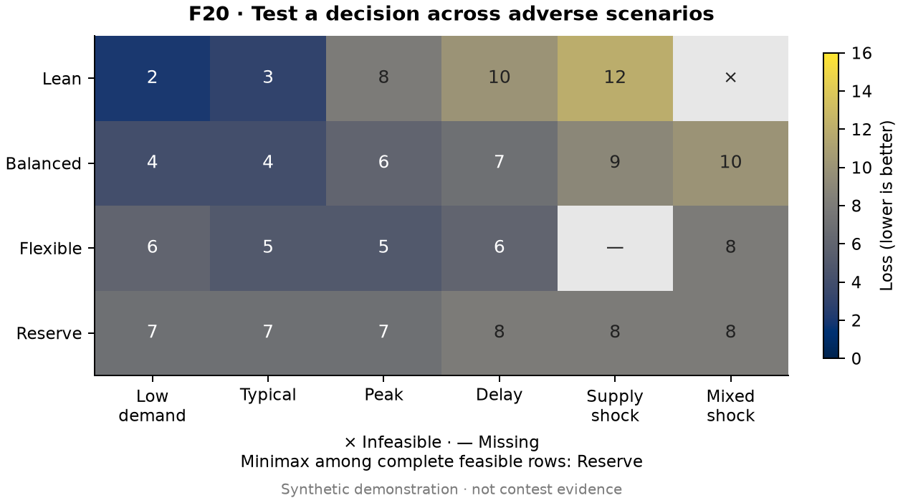

[Vector PDF](f20-scenarios.pdf). The script defines a synthetic loss table for four
plans and six scenarios. All cells share the same loss scale; × is infeasible
and — is unobserved. Among rows feasible and observed in every scenario, Reserve
has the smallest maximum loss (8, versus Balanced's 10). Flexible cannot be
ranked by this complete-case minimax rule because one outcome is unknown. No
scenario probabilities are specified, so the figure reports no expected loss.

## Advanced gallery / 进阶样张

These previews come from
[render_advanced_examples.py](../scripts/render_advanced_examples.py), which
calls the skill's own [advanced templates](../templates/advanced_templates.py)
and [experiment kits](../templates/experiment_kits.py) on synthetic inputs. They
are PNG only (120 dpi); run the script for vector PDFs. Each input below is
either a standard test problem or an explicitly invented series.

| | |
|---|---|
|  | 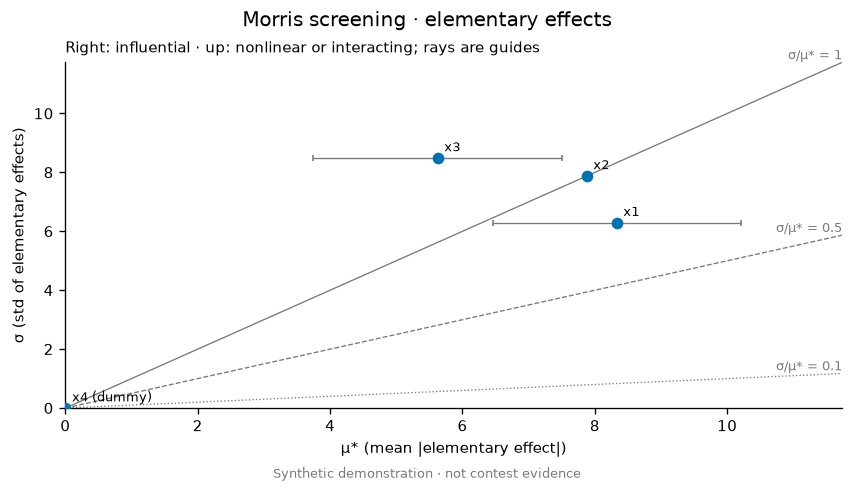 |
| **F21** `oat_sweep` (21 points per input) of the annual ordering + holding cost when the order size was fixed from baseline estimates D=10000, S=50, H=4; m scales that order size. Cost is linear in D, S and H, but U-shaped in m, so both m bounds raise it: same-side bars, and the black sweep line shows the range inside each interval. | **F22** Morris screening of the Ishigami test function (a=7, b=0.1) plus an unused dummy x4, r=40, four levels, with 400-resample bootstrap intervals for μ\*. The dummy sits at the origin; x3 has σ > μ\*, flagging its interaction with x1. |
|  | 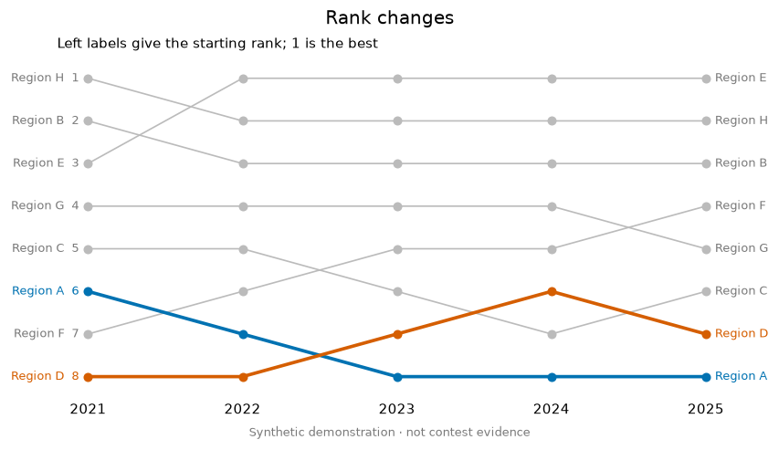 |
| **F23** Twenty seeded runs each of random search, simulated annealing and a (1+1)-ES with the one-fifth rule on the 8-D Rastrigin function, 300 evaluations each. Bands are run-to-run IQRs. | **F24** Ranks of eight invented regions over five periods from random-walk scores; two are highlighted. |
| 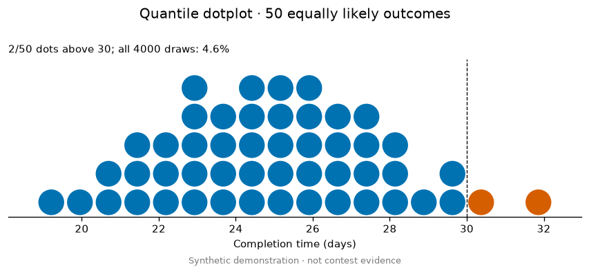 | 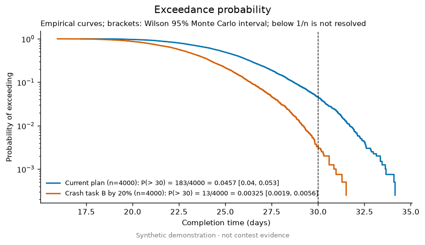 |
| **F25** 4000 `monte_carlo` draws of the duration of three sequential tasks with triangular durations, shown as 50 quantile dots against a 30-day deadline. | **F26** The same plan against a variant that shortens task B by 20%, using common random numbers to reduce the variance of the comparison; the legend gives k/n with a Wilson 95% interval. |
| 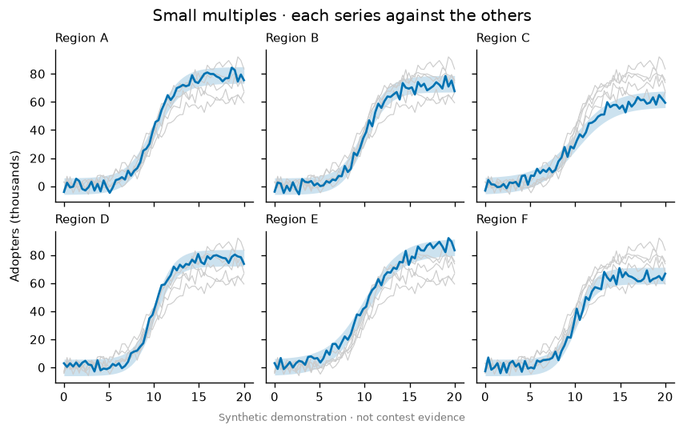 | 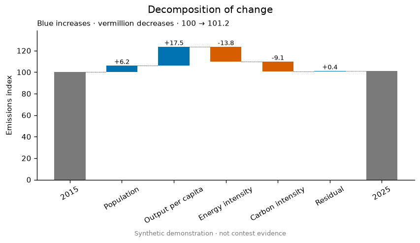 |
| **F27** Six invented logistic adoption curves with Normal(0, 3²) noise; bands are the known-model 95% range, not estimates. | **F28** An invented additive decomposition of an emissions index into four factors plus a residual; the template checks that the parts sum to the end value. |
| 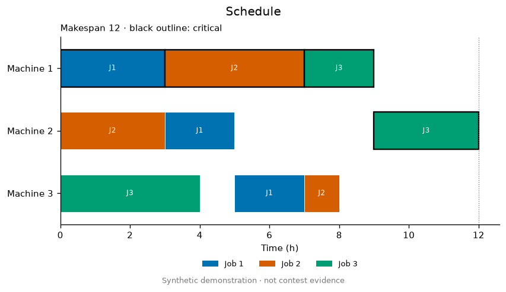 | 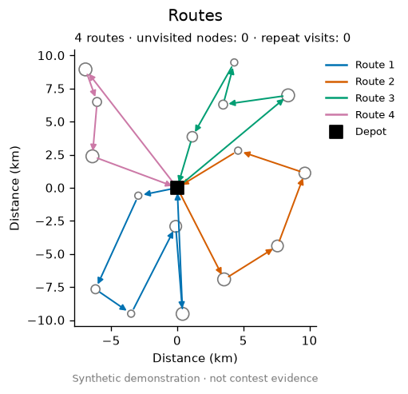 |
| **F29** A hand-built feasible three-job, three-machine schedule; outlined bars are the critical path J1 → J2 → J3 on Machine 1, then J3 on Machine 2. | **F30** Sixteen random customers with integer demand, routed by a sweep heuristic under capacity 15, deliberately simple and not optimized. |
|  | 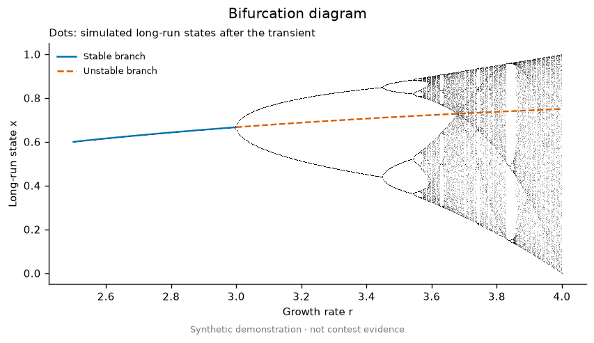 |
| **F31** Predator–prey model with logistic prey, x′ = x(1 − x/3) − xy, y′ = −y + xy, solved by fourth-order Runge–Kutta. (1, 2/3) is a stable spiral; (0, 0) and (3, 0) are saddles. | **F32** Logistic map xₙ₊₁ = r xₙ(1 − xₙ), 500 discarded and 120 kept iterations per r, with the analytic fixed point 1 − 1/r, stable for r < 3. |
| 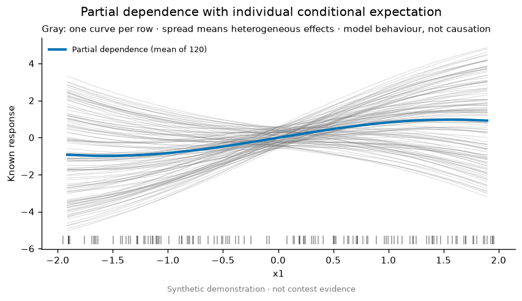 | 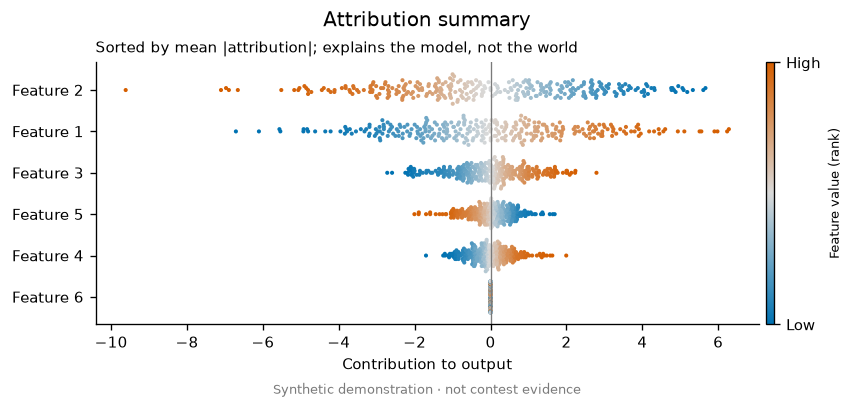 |
| **F33** ICE curves of a known function sin(x1) + x1·x2 + 0.3x3 over 120 random rows; the x1·x2 term makes the curves fan out. | **F34** Exact Shapley values w·(x − x̄) of a known linear model with independent inputs; feature 6 has zero weight. |
| 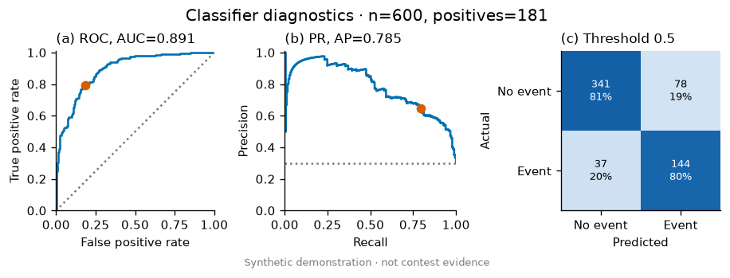 | 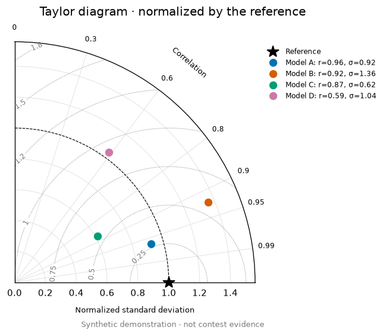 |
| **F35** 600 invented labels (30% positive) with logistic scores shifted by class; threshold 0.5 chosen in advance. | **F36** Four invented model series compared with a sine reference after scaling, phase shifts and noise. |
| 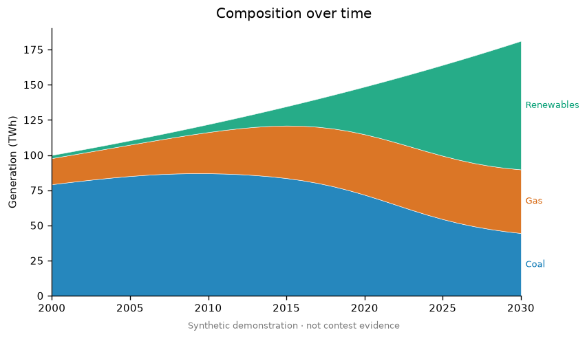 | 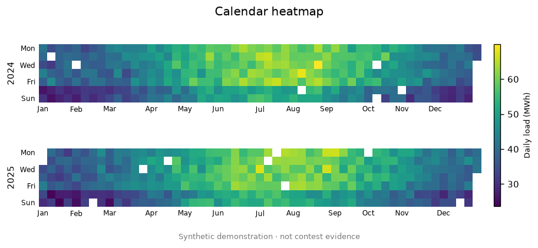 |
| **F37** An invented three-source generation mix with logistic transitions and 2% compound annual growth. | **F38** Two years of invented daily load with a seasonal cosine, weekend dip and noise; about 3% of days are removed to show gaps. |
|  | 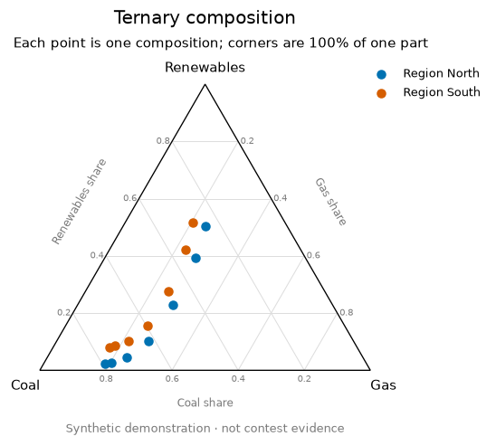 |
| **F39** A random 6×5 indicator matrix with entropy weights and TOPSIS closeness; rank probabilities come from `rank_stability` with Dirichlet concentration 60 over 1000 weight draws. | **F40** Shares from the F37 mix every five years for two invented regions. |

| 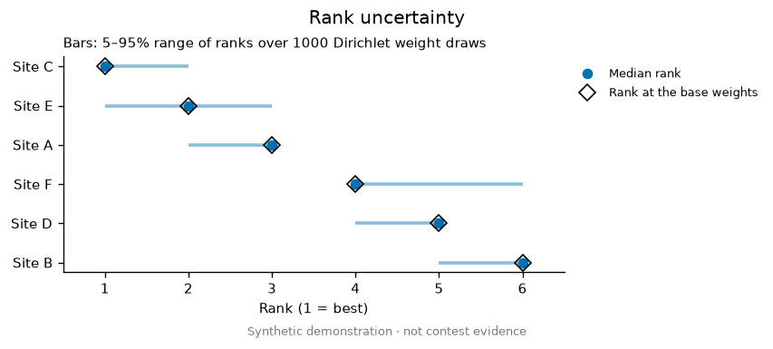 | 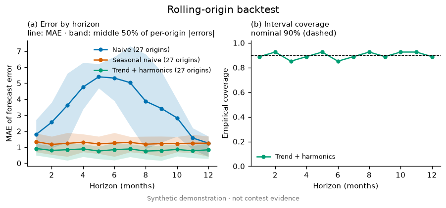 |
| **F41** Median ranks and 5–95% rank ranges of the F39 sites over the same 1000 Dirichlet weight draws; diamonds mark ranks at the entropy weights. | **F42** Rolling-origin backtest (27 origins, 12-month horizon) of an invented trend + seasonal series: naive, seasonal naive and a trend + harmonics regression fitted only on each origin's past; coverage of its ±1.645σ residual interval against the nominal 90%. |
| 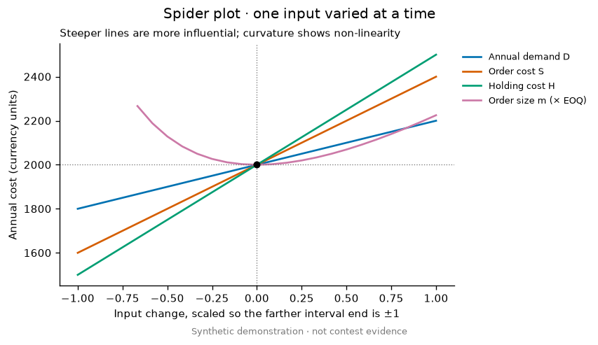 |  |
| **F43** The F21 sweep shown as a spider plot, each input scaled so its farther interval end is ±1; the U-shaped curve is the order size. | **F44** Forty invented instances whose solve times are a shared lognormal difficulty times solver-specific lognormal factors; times over 12 s count as failures. |
| 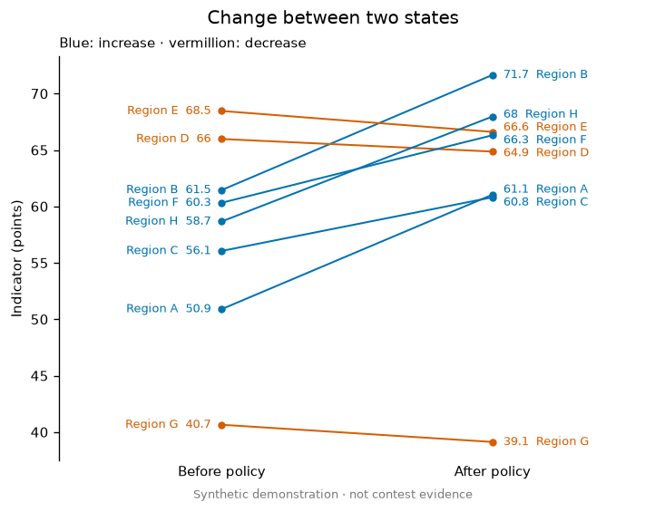 | 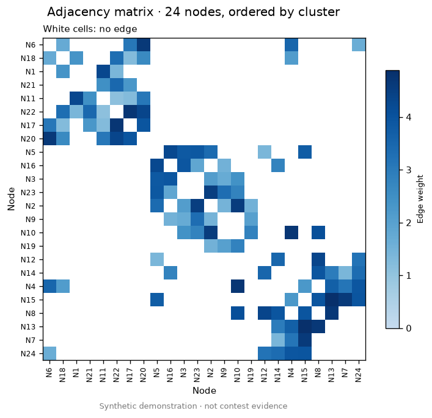 |
| **F45** Eight invented regional indicators before and after a change, with labels nudged apart. | **F46** A 24-node network with three planted communities (edge probability 0.6 within, 0.05 between) and shuffled labels; Jaccard-linkage ordering recovers the blocks. |

```bash
python3 .claude/skills/mathodology-figure-presets/scripts/render_advanced_examples.py --output work/figure-examples-advanced --seed 20261022
python3 .claude/skills/mathodology-figure-presets/scripts/render_advanced_examples.py --self-test
```

The self-test checks the Sobol kit against the known Ishigami indices and its
seeded intervals for reproducibility, the Morris dummy, OAT's blind spot,
rolling-origin errors and covariate withholding, paired summaries, a profile
curve, AHP weights and consistency, Euler's first-order convergence, parameter
recovery, interval coverage, tie handling in rank stability, tornado ordering,
that no quantile dot straddles the threshold, that the drawn PR area equals AP,
LaTeX escaping and the rejection of invalid inputs, then renders all twenty-six
templates. To refresh these previews deliberately, add `--dpi 120` and
`--output .claude/skills/mathodology-figure-presets/examples`, then delete the PDFs.

## Reproduce and inspect

From the repository root, using an environment with NumPy and Matplotlib:

```bash
python3 .claude/skills/mathodology-figure-presets/scripts/render_examples.py --output work/figure-examples --seed 20260907
python3 .claude/skills/mathodology-figure-presets/scripts/render_examples.py --self-test
```

The seed reproduces inputs. To refresh the committed gallery deliberately, set
`--output .claude/skills/mathodology-figure-presets/examples`. The script only
writes its twelve named PNG/PDF outputs and leaves this README intact.

Initial gallery rendered with Python 3.14, NumPy 2.5.3, Matplotlib 3.11.1 and the
bundled DejaVu Sans font. Figures are 7 inches wide (about 178 mm), use 9 pt base
text, and export PNG at 180 dpi for compact previews plus vector PDF. Production
exports can use 300 dpi or the actual contest specification. Rendering bytes may
vary by library/font version even when the source values match.

Check full-size PNGs and vector PDFs at their final paper width. The demo's
self-test checks numerical meanings and output formats; it does not certify
visual quality or exercise an image2 service. Adapt the code and prompts to the
actual data, units, inference and language rather than treating it as a fixed
plotting framework.
