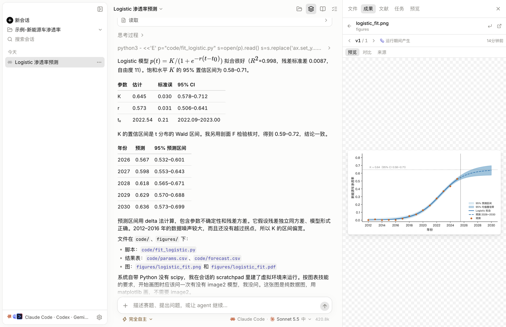

<p align="center">
  
</p>

<h1 align="center">Mathodology</h1>

<p align="center">
  数学建模竞赛的 agent 技能包与桌面工作台<br>
  <b>简体中文</b> · <a href="README_en.md">English</a>
</p>

<p align="center">
  <a href="https://github.com/sweetcornna/mathodology/releases/latest"></a>
  <a href="LICENSE"></a>
</p>



Mathodology 让 Claude Code、Codex 和 Gemini CLI 按数模的方式工作：读懂题目，
建立可解释的模型，用实验检验结论，画出说明问题的图，只引用查得到的文献，
再把论文写清楚。

## 包含什么

| | |
| --- | --- |
| **8 个技能** | 建模提示、证据检索、科学绘图、审稿问题等，见[技能索引](docs/SKILLS_zh.md) |
| **8 个专业角色** | 统筹、题目分析、建模、编程、文献、审稿、写作、打包，按需并行 |
| **46 类图表模板** | 可调用的 Matplotlib 代码，填入真实数据直接出 PNG/PDF |
| **18 个实验组件** | 敏感性、蒙特卡罗、回测、消融、排名稳定性等数模常见实验 |
| **引用核验** | `verify_refs.py` 逐条核对 DOI、标题、作者、年份和撤稿声明 |
| **Studio 桌面应用** | 一个窗口驱动本机 agent，成果自动存版本，审阅可追溯 |

## 图表与实验

<table>
  <tr>
    <td width="33%"><br><sub>预测区间</sub></td>
    <td width="33%"><br><sub>龙卷风敏感性图</sub></td>
    <td width="33%"><br><sub>多次运行收敛带</sub></td>
  </tr>
  <tr>
    <td><br><sub>相图</sub></td>
    <td><br><sub>综合评价矩阵</sub></td>
    <td><br><sub>算法性能剖面</sub></td>
  </tr>
</table>

[20 类基础预设](.claude/skills/mathodology-figure-presets/references/presets.md)和
[26 类进阶预设](.claude/skills/mathodology-figure-presets/references/presets-advanced.md)
各附数据要求、布局、误导反例、绘图和图注提示词。
[实验组件](.claude/skills/mathodology-figure-presets/references/experiments.md)调用你的模型、
返回数组，直接交给对应图表并生成三线表。样张均为合成数据，见
[示例图库](.claude/skills/mathodology-figure-presets/examples/README.md)。

首次绘图时 agent 会问一次是否有 image2。没有也能完成：数值图始终由数据和代码绘制。

## Mathodology Studio

[Studio](apps/studio/README.md) 是开源桌面工作台（macOS、Windows、Linux），不调用模型 API，
不保存密钥，不收集数据。

- 驱动本机已登录的 Claude Code、Codex 或 Gemini CLI，回合之间可切换
- 图表、表格和代码每次修改都存一个版本，可对比、恢复，并追溯到产生它的回合
- 只读审阅把每条结论对照工具记录；引用逐条溯源，DOI 系统查无此号的标为疑似编造
- 文献面板检索论文，核验 DOI 后写入 `references.bib`，并可逐条核对整份参考文献
- 自动安装 [humanizer](https://github.com/blader/humanizer)，改掉论文里的 AI 腔；每次启动检查并更新
- MCP 连接器在设置里配一次，三个 agent 同步使用；内置检索 free-search-mcp 每次启动更新到最新版

**下载 v0.17.0**：[macOS DMG](https://github.com/sweetcornna/mathodology/releases/download/v0.17.0/Mathodology-Studio-0.17.0-arm64.dmg)（Apple 芯片）·
[Windows 安装包](https://github.com/sweetcornna/mathodology/releases/download/v0.17.0/Mathodology-Studio-0.17.0-x64-setup.exe)（x64）·
[Linux .deb / AppImage](https://github.com/sweetcornna/mathodology/releases/tag/v0.17.0)（x64、arm64）。
应用未签名：macOS 首次打开请在访达里按住 Control 点按应用，选择“打开”；Windows 弹出 SmartScreen
时点“更多信息”→“仍要运行”；Ubuntu 23.10 及以后请用 .deb，那里的 AppImage 用不了 Chromium 沙箱。
Windows 安装包的签名方式见[代码签名策略（Code signing policy）](apps/studio/README.md#code-signing-policy)。
需要先装好并登录至少一个 agent CLI。

或从源码运行（Node.js 22.12+、pnpm 10）：

```bash
cd apps/studio && pnpm install && pnpm dev
```

## 快速开始

在已有项目里安装技能（Claude Code 把最后一个参数换成 `claude-code`）：

```bash
npx -y skills@latest add sweetcornna/mathodology --copy --yes --skill '*' --agent codex
```

然后对 agent 说：

> 使用 mathodology-whole-project 分析这道建模题。从题目、数据和约束出发，
> 建立可解释的基线，验证影响结论的假设，用 mathodology-figure-presets
> 选择有用的图表。保留可复现计算和证据来源，交付结果、图表与清楚的局限。

完整仓库还带角色、工作流和检索 MCP 配置，见[安装与更新](docs/INSTALL_zh.md)。

## 文档

[技能](docs/SKILLS_zh.md) · [工作提示词](docs/WORKFLOWS_zh.md) · [安装](docs/INSTALL_zh.md) ·
[备份](docs/BACKUP_zh.md) · [Studio](apps/studio/README.md) ·
[给 agent 的绘图指导](.claude/skills/mathodology-figure-presets/references/figure-guidance.md)

维护源在 `.claude/skills/`，`.agents/skills/` 是不入库的本地镜像。仓库不含比赛数据集。
原创内容采用 [MIT](LICENSE) 许可，第三方素材保留各自许可。
