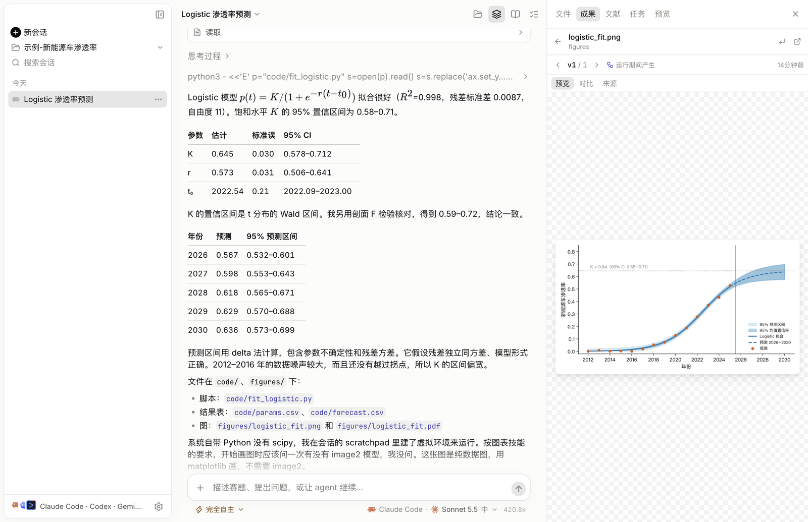
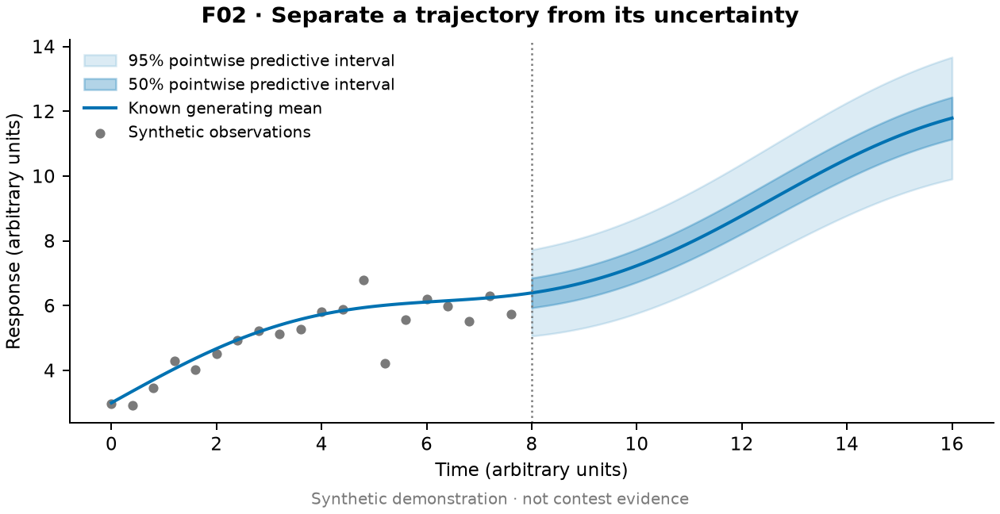
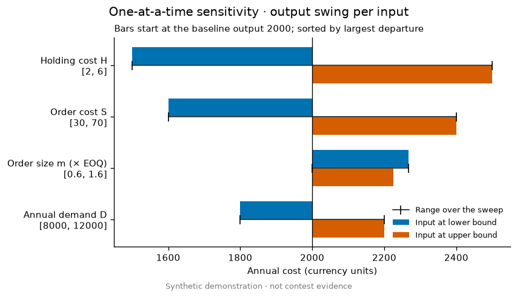
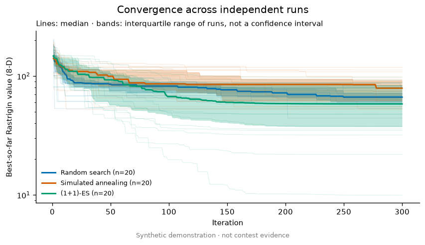
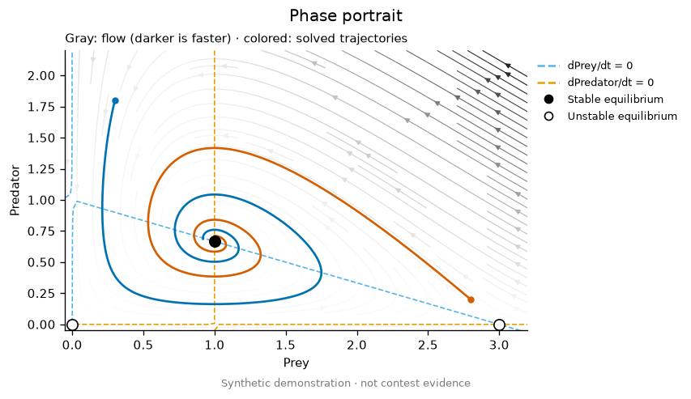
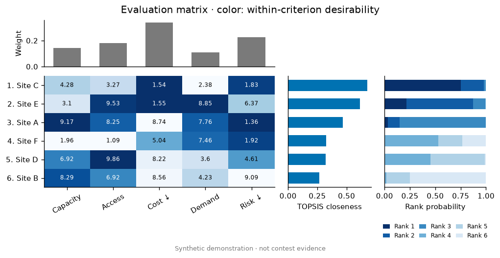
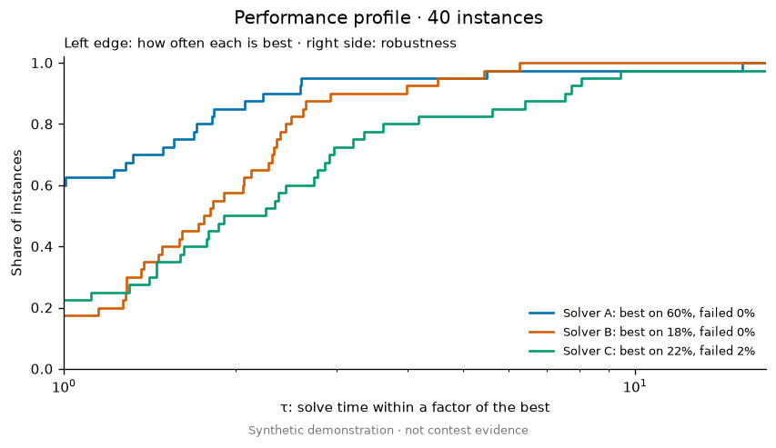

<p align="center">
  
</p>

<h1 align="center">Mathodology</h1>

<p align="center">
  <b>数学建模竞赛的 AI Agent 技能包、可执行工作台与桌面应用</b><br>
  <b>简体中文</b> · <a href="README_en.md">English</a>
</p>

<p align="center">
  <a href="https://github.com/sweetcornna/mathodology/releases/latest"></a>
  <a href="LICENSE"></a>
  
</p>



直接让编程 Agent 做数学建模，最常见的问题不是写不出代码，而是**手改结果数字、图表与数据脱节、瞎编参考文献、改几轮就丢上下文**。

**Mathodology** 把竞赛建模做成一条可核验的工程链，驱动本机已有的 **Claude Code、Codex、Antigravity CLI、Qoder CLI、pi** 等二十多种编程 Agent 按数模规范干活：

- **所有数字来自代码**：结果由脚本写入 `results/*.json`，论文用 `\res{...}` 宏引用，钩子禁止手改结果。
- **图表与实验成套交付**：46 类科研图表模板 + 18 个标准实验套件，直接喂真实数据出 PNG / PDF 与三线表。
- **引用逐条查证**：查 DOI、标题、作者、年份和撤稿状态，查无此号的直接标红。
- **全程留痕可审阅**：桌面端自动给每个产物存版本，可只读复核每一条结论与出处。

---

## 两种使用方式

| 方式 | 适合谁 | 你会得到什么 |
|---|---|---|
| **[Mathodology Studio](#mathodology-studio)**（桌面工作台） | 想开箱即用、边对话边看文件/图表/文献/检查面板的参赛队 | 一个窗口驱动本机 20+ 种 Agent CLI，自动建赛题目录、装技能与钩子、版本管理、文献查验与只读审阅 |
| **[CLI 技能包](#cli-快速开始)**（`npx skills` / Git 仓库） | 习惯留在终端里直接用 Claude Code / Codex 的用户 | 9 个技能、8 个专业角色、46 类图表与 18 个实验套件、`mtd.py` 可执行工作台和 `verify_refs.py` |

> **零隐私收集、零密钥托管**：Mathodology 不内置模型 API、不保存任何 API Key、不回传任何比赛数据。每一次对话都直接走你本机已登录的 Agent CLI 和对应账号。

---

## Mathodology Studio

[Mathodology Studio](apps/studio/README.md) 是跨平台开源桌面工作台（macOS / Windows / Linux），把对话、代码产物、工作台检查和文献查验放到同一个窗口里：

- **驱动 20+ 种本机 Agent CLI**：原生支持 Claude Code、Codex、Antigravity CLI、Qoder CLI、pi、oh-my-pi，以及 OpenCode、Cursor CLI、Copilot CLI 等 ACP Agent；各走官方程序接口，**同一会话中可在不同回合自由切换 Agent 与模型**。
- **开箱即建竞赛项目**：新建项目时按赛事（国赛 CUMCM、美赛 MCM/ICM、统计建模、华为杯、MathorCup、亚太赛）生成论文骨架，自动装好 6 个竞赛技能、8 个专业角色、工作流提示词与 Claude Code 钩子。
- **可视化工作台检查（Checks）**：一键运行 `mtd.py` 检查题意拆解、实验、结果、图表和论文五个环节，点击问题直接跳到对应文件与行号，支持一键刷新 `\res` 宏与编译论文。
- **产物自动版本化**：图表、表格、代码、文档每次改动自动存为不可变版本，可追踪到具体回合与工具调用，支持文本 diff、图片左右对比与一键回退。
- **只读审阅 & 引用溯源**：独立只读会话把论文和回复里的每一条论断对照工具执行记录；审阅前先自动追踪所有 DOI / arXiv / PMID / `\cite`，DOI 系统查无此号的标为疑似编造。
- **文献检索 & BibTeX 体检**：内置零密钥检索（`free-search-mcp`），合并预印本与正式版，核验 DOI 无误后再写入 `paper/references.bib`，并支持对整份 `.bib` 逐条查撤稿与元数据漂移。
- **去 AI 腔 & 统一连接器**：自动安装并更新 [humanizer](https://github.com/blader/humanizer)；MCP 连接器在设置里配一次，自动同步给多个 Agent，绝不破坏你手写的配置。
- **细粒度控制**：消息队列、交互式提问卡片（私密回答自动脱敏不落盘）、逐工具审批卡片、明暗主题与中英文界面。

### 下载 v0.19.0

> 使用前请先在本机安装并登录至少一个 Agent CLI（如 Claude Code、Codex、Antigravity CLI 等）。

| 平台 | 下载包 | 说明 |
|---|---|---|
| **macOS**（Apple 芯片） | [Mathodology-Studio-0.19.0-arm64.dmg](https://github.com/sweetcornna/mathodology/releases/download/v0.19.0/Mathodology-Studio-0.19.0-arm64.dmg) · [ZIP](https://github.com/sweetcornna/mathodology/releases/download/v0.19.0/Mathodology-Studio-0.19.0-arm64-mac.zip) | 已使用 Apple Developer ID 证书签名并开启 Hardened Runtime（当前未经过 Apple 公证，如从浏览器下载后首次打开被系统拦截，请在访达中按住 Control 点按应用选择“打开”） |
| **Windows**（x64） | [Mathodology-Studio-0.19.0-x64-setup.exe](https://github.com/sweetcornna/mathodology/releases/download/v0.19.0/Mathodology-Studio-0.19.0-x64-setup.exe) | 未签名；如弹出 SmartScreen，点“更多信息”→“仍要运行”。Windows 签名计划见[代码签名策略](apps/studio/README.md#code-signing-policy) |
| **Linux**（x64 / arm64） | [`.deb` 与 `AppImage`（v0.19.0 Release）](https://github.com/sweetcornna/mathodology/releases/tag/v0.19.0) | Ubuntu 23.10 及以后请使用 `.deb`（AppImage 受 AppArmor 限制无法启用 Chromium 沙箱） |

或从源码启动（需要 Node.js 22.12+、pnpm 10）：

```bash
cd apps/studio
pnpm install
pnpm dev
```

---

## 可执行工作台：从题目到论文的硬约束

[mathodology-workbench](.claude/skills/mathodology-workbench/SKILL.md) 用真实文件而不是口头约定把五个阶段串起来，纯 Python 标准库实现，零额外依赖：

| 阶段 | 核心产物 | 可执行检查与自动化 |
|---|---|---|
| **1. 题意拆解** | `problem/questions.json` | `mtd.py brief` 识别顶层小问，明确交付物、指标、输入与假设 |
| **2. 编程实验** | `code/` + 运行清单 | `mtd.py run -- python code/q1.py` 记录命令、随机种子、输入哈希、产出与退出码；拦截空壳函数和只有 `pass` 的占位脚本 |
| **3. 结果验证** | 代码写出的 `results/*.json` | 校验格式、区间、来源与同名键冲突；代码或题目输入变过但结果没重跑会自动标过期 |
| **4. 科学制图** | 读取结果的绘图脚本与图片 | 追踪“脚本 → 数据 → 图片”血缘，揪出过期、缺失、损坏或分辨率不足的图 |
| **5. 论文写作** | 使用 `\res{q1.rmse}` 的 LaTeX / Markdown | `mtd.py sync` 生成结果宏与 `paper/tables/` 三线表；检查未定义宏/字段、引用、交叉引用、PDF 新鲜度、编译日志与赛事格式规范 |

在 Claude Code 中，四个工作台钩子会自动接管检查：
1. **会话开始**：汇报五个阶段当前进度与阻塞项；
2. **写入拦截**：拒绝直接手改 `results/*.json`，确保所有结果都由重跑代码产出；
3. **保存联动**：改完论文立刻静态检查，跑完实验自动同步宏与三线表；
4. **结束把关**：收尾前若仍有报错（未定义引用、缺图、缺失结果字段等），自动提示 Agent 修复或说明原因。

```bash
# 初始化工作区与赛事论文骨架（可选 cumcm / mcm / stats / huawei / mathorcup / apmcm）
python3 .claude/skills/mathodology-workbench/scripts/mtd.py init --paper-template cumcm

# 同步结果宏、编译论文并做全量检查
python3 .claude/skills/mathodology-workbench/scripts/mtd.py check --compile
```

> `check` 会按已核实的官方规则校验目录、页数与匿名要求（国赛、美赛、统计建模已核实；华为杯、MathorCup、亚太赛格式规则请以当年官方通知为准）。详见[赛事论文格式](.claude/skills/mathodology-workbench/references/contest-formats.md)。

---

## 科学图表与实验套件

<table>
  <tr>
    <td width="33%"><br><sub>F02 预测区间</sub></td>
    <td width="33%"><br><sub>F21 龙卷风敏感性图</sub></td>
    <td width="33%"><br><sub>F23 多次运行收敛带</sub></td>
  </tr>
  <tr>
    <td><br><sub>F31 相图</sub></td>
    <td><br><sub>F39 综合评价矩阵</sub></td>
    <td><br><sub>F44 算法性能剖面</sub></td>
  </tr>
</table>

- **46 类图表模板**：[20 类基础预设](.claude/skills/mathodology-figure-presets/references/presets.md) + [26 类进阶预设](.claude/skills/mathodology-figure-presets/references/presets-advanced.md)，每类附数据要求、布局要点、常见误导反例、可调用的 Matplotlib 代码与图注规范。
- **18 个标准实验组件**：覆盖敏感性分析、蒙特卡罗、滚动回测、消融实验、排名稳定性等（见[实验组件手册](.claude/skills/mathodology-figure-presets/references/experiments.md)），直接调用你的模型返回数组并产出对应图表与三线表。
- 全部预览均使用合成数据生成，见[示例图库](.claude/skills/mathodology-figure-presets/examples/README.md)。首次绘图时 Agent 会询问一次是否可用 `image2`（仅用于概念示意图，数值图始终由数据和代码绘制，没有也能完整交付）。

---

## CLI 快速开始

在已有项目目录中直接安装技能包（Claude Code 将最后一个参数改为 `claude-code`）：

```bash
npx -y skills@latest add sweetcornna/mathodology --copy --yes --skill '*' --agent codex
```

随后对 Agent 说：

> 使用 mathodology-whole-project 分析这道建模题。从题目、数据和约束出发，建立可解释的基线，验证影响结论的假设，用 mathodology-figure-presets 选择有用的图表。保留可复现计算和证据来源，交付结果、图表与清楚的局限。

如需同时使用工作台钩子、8 个专业角色和零密钥文献检索 MCP，见[安装与更新指南](docs/INSTALL_zh.md)。

---

## 仓库内容一览

| 模块 | 位置 | 说明 |
|---|---|---|
| **9 个技能** | `.claude/skills/` | 唯一维护源（6 个竞赛核心技能 + 3 个仓库维护技能），见[技能索引](docs/SKILLS_zh.md) |
| **8 个专业角色** | `.claude/agents/` · `.codex/agents/` | 统筹、题意分析、建模、计算、证据、审稿、写作、打包，按需并行调用 |
| **工作流提示词与钩子** | `.claude/workflows/` · `.claude/settings.json` | 端到端交付提示词与工作区自动检查钩子 |
| **引用核验工具** | `.claude/skills/mathodology-evidence-search/scripts/verify_refs.py` | 核对 DOI、arXiv、标题、作者、年份与撤稿状态 |
| **Studio 桌面端** | `apps/studio/` | Electron + React + TypeScript 桌面工作台源码与打包配置 |
| **项目文档** | `docs/` | [技能](docs/SKILLS_zh.md) · [工作方式](docs/WORKFLOWS_zh.md) · [安装](docs/INSTALL_zh.md) · [备份](docs/BACKUP_zh.md) · [Studio 详述](apps/studio/README.md) · [Agent 绘图指导](.claude/skills/mathodology-figure-presets/references/figure-guidance.md) |

> `.agents/skills/` 为不入库的本地 Codex 镜像；仓库不包含任何比赛数据集。原创内容采用 [MIT](LICENSE) 许可，第三方参考素材保留各自原许可。
