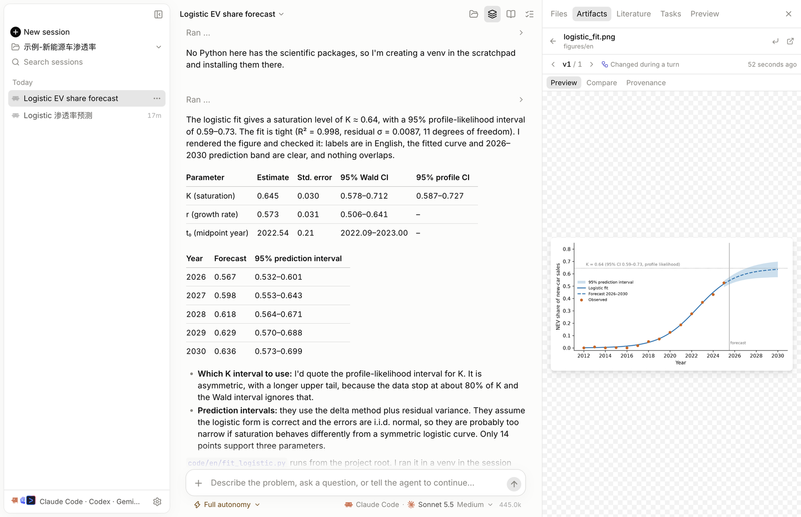
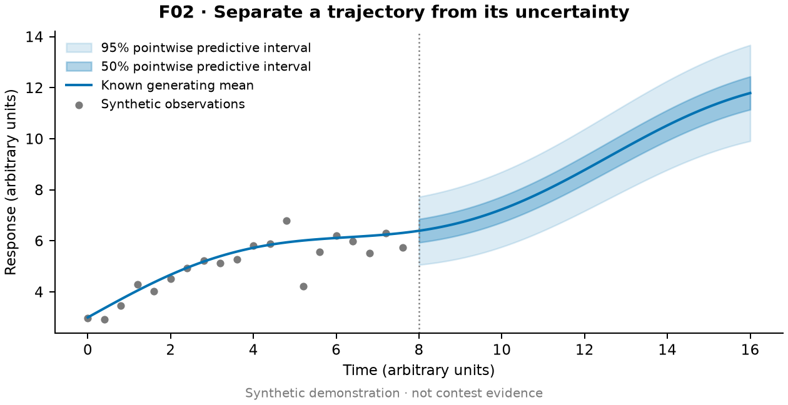
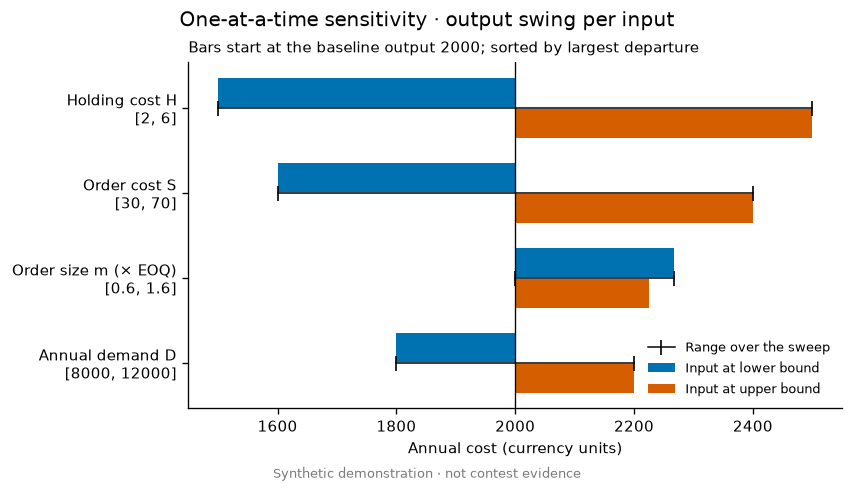
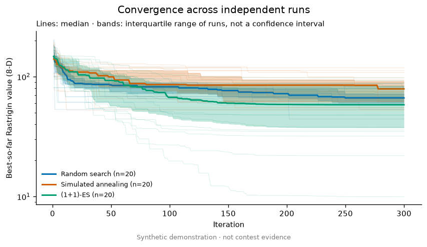
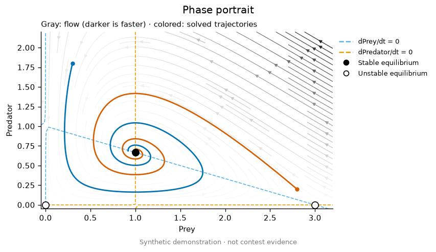
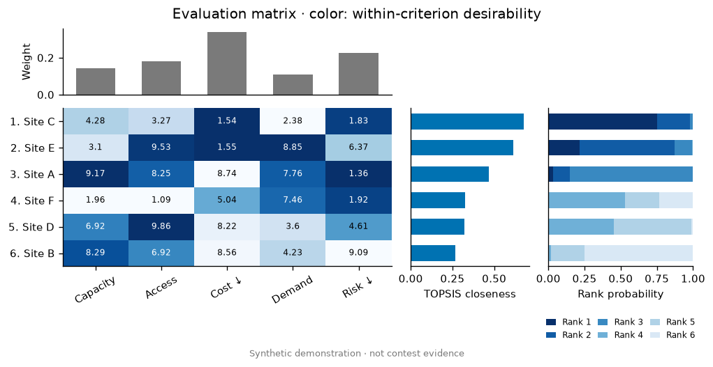
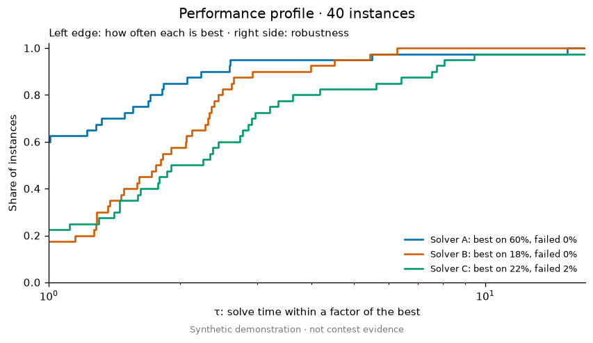

<p align="center">
  
</p>

<h1 align="center">Mathodology</h1>

<p align="center">
  <b>Agent skills, an executable workbench, and a desktop app for mathematical modeling contests</b><br>
  <a href="README.md">简体中文</a> · <b>English</b>
</p>

<p align="center">
  <a href="https://github.com/sweetcornna/mathodology/releases/latest"></a>
  <a href="LICENSE"></a>
  
</p>



When coding agents tackle mathematical modeling contests out of the box, the failure modes are predictable: **hand-edited numbers, figures that drift from code, fabricated citations, and lost context across iterations**.

**Mathodology** turns local coding agents (**Claude Code, Codex, Antigravity CLI, Qoder CLI, pi**, and 20+ ACP CLIs) into a verifiable modeling workflow:

- **Every number comes from code**: scripts write `results/*.json`, the paper cites `\res{...}` macros, and hooks block manual edits to result files.
- **Publication-grade figures and experiments**: 46 callable Matplotlib presets and 18 standard experiment kits bind directly to your data to produce PNG/PDF figures and booktabs tables.
- **Verified citations only**: `verify_refs.py` and Studio's Literature/Review panes check DOIs, titles, authors, years, and retraction notices—flagging unresolvable DOIs as likely fabricated.
- **Traceable from turn to deliverable**: Mathodology Studio versions every figure, table, and script automatically and runs read-only reviews against the actual tool record.

---

## Two ways to use Mathodology

| Workflow | Best for | What you get |
|---|---|---|
| **[Mathodology Studio](#mathodology-studio)** (Desktop app) | Teams who want an all-in-one workspace with conversation, files, checks, artifacts, and literature side by side | One window driving 20+ local agent CLIs, automatic project setup, versioned outputs, live workbench checks, literature search, and traceable reviews |
| **[CLI Skills Pack](#cli-quick-start)** (`npx skills` / git checkout) | Users working directly inside Claude Code, Codex, or Antigravity CLI in the terminal | 9 skills, 8 specialist roles, 46 figure templates, 18 experiment kits, the `mtd.py` workbench, and `verify_refs.py` |

> **Local-first and private**: Mathodology calls no model APIs, stores no API keys, and collects no telemetry. Every turn runs through the agent CLI already signed in on your machine under your own account.

---

## Mathodology Studio

[Mathodology Studio](apps/studio/README.md) is an open-source desktop workbench for macOS, Windows, and Linux:

- **20+ local agent CLIs**: Native support for Claude Code, Codex, Antigravity CLI, Qoder CLI, pi, and oh-my-pi, plus OpenCode, Cursor CLI, Copilot CLI, and other ACP agents—each via its official programmatic protocol, with **mid-session switching between turns**.
- **Contest-ready project scaffolding**: Pick a contest (CUMCM, MCM/ICM, 统计建模, 华为杯, MathorCup, APMCM) to generate the matching paper skeleton and install the 6 contest skills, 8 roles, workflow prompts, and Claude Code hooks.
- **Live Workbench Checks**: Inspect the five stages (brief, experiments, results, figures, paper) in one pane, jump straight from any finding to its file and line, refresh `\res` macros, and compile the paper.
- **Immutable artifact versioning**: Every edit to a figure, table, code file, or draft creates a checksummed version linked to its originating turn, with line diffs, side-by-side image comparison, and one-click restore.
- **Read-only review & citation trace**: Before reviewing claims against tool logs, Studio traces every DOI, arXiv ID, PMID, and `\cite` key and flags unknown DOIs, missing keys, or retracted papers.
- **Literature search & BibTeX verification**: Powered by zero-key `free-search-mcp`, folding preprints with published versions, checking DOIs before appending to `paper/references.bib`, and auditing entire bibliographies entry by entry.
- **De-AI prose & shared MCP connectors**: Automatically installs and updates [humanizer](https://github.com/blader/humanizer); configure MCP servers once in Settings to sync across agents without disturbing user-managed config.
- **Built for real workflows**: Message queues, interactive question cards (secret inputs redacted before persistence), per-tool approval cards, light/dark themes, and English/Chinese UI.

### Download v0.19.0

> Install and sign in to at least one local agent CLI (Claude Code, Codex, Antigravity CLI, etc.) before launching Studio.

| Platform | Download | Notes |
|---|---|---|
| **macOS** (Apple silicon) | [Mathodology-Studio-0.19.0-arm64.dmg](https://github.com/sweetcornna/mathodology/releases/download/v0.19.0/Mathodology-Studio-0.19.0-arm64.dmg) · [ZIP](https://github.com/sweetcornna/mathodology/releases/download/v0.19.0/Mathodology-Studio-0.19.0-arm64-mac.zip) | Signed with an Apple Developer ID certificate and Hardened Runtime enabled (not yet Apple-notarized; if Gatekeeper prompts on first launch after downloading from a browser, Control-click the app in Finder and choose **Open**) |
| **Windows** (x64) | [Mathodology-Studio-0.19.0-x64-setup.exe](https://github.com/sweetcornna/mathodology/releases/download/v0.19.0/Mathodology-Studio-0.19.0-x64-setup.exe) | Unsigned; choose **More info → Run anyway** if SmartScreen appears. See the [code signing policy](apps/studio/README.md#code-signing-policy) |
| **Linux** (x64 / arm64) | [`.deb` & `AppImage` (v0.19.0 Release)](https://github.com/sweetcornna/mathodology/releases/tag/v0.19.0) | Use `.deb` on Ubuntu 23.10+ (AppArmor restricts Chromium's sandbox in AppImages) |

Or run from source (Node.js 22.12+, pnpm 10):

```bash
cd apps/studio
pnpm install
pnpm dev
```

---

## Executable Workbench: Enforcing the Path from Problem to Paper

[mathodology-workbench](.claude/skills/mathodology-workbench/SKILL.md) links five stages through real files rather than prompt conventions, using Python's standard library alone:

| Stage | Output | Automated checks |
|---|---|---|
| **1. Problem brief** | `problem/questions.json` | `mtd.py brief` identifies top-level questions, deliverables, metrics, inputs, and assumptions |
| **2. Experiments** | `code/` + run manifests | `mtd.py run -- python code/q1.py` logs command, seed, input hashes, outputs, and exit status; catches stub scripts and `pass`-only functions |
| **3. Results** | Code-generated `results/*.json` | Validates schema, intervals, provenance, and key/table collisions; flags stale results whenever code or problem inputs change |
| **4. Figures** | Plotting scripts + rendered figures | Traces `script → data → figure`; detects stale, missing, corrupt, or low-DPI images |
| **5. Paper** | LaTeX / Markdown citing `\res{q1.rmse}` | `mtd.py sync` generates macros and booktabs tables in `paper/tables/`; checks undefined keys/fields, citations, cross-refs, PDF freshness, compile logs, and contest rules |

In Claude Code, four hooks run automatically inside contest workspaces:
1. **Session start**: reports stage status and open blockers.
2. **Write guard**: refuses manual edits to `results/*.json` so numbers only come from rerunning code.
3. **Post-edit / post-run**: checks edited paper files immediately and refreshes macros after experiment runs.
4. **Stop check**: prompts once before finishing if blocking errors remain (undefined citations, missing figures, broken result keys).

```bash
# Initialize workspace with a contest skeleton (cumcm, mcm, stats, huawei, mathorcup, apmcm)
python3 .claude/skills/mathodology-workbench/scripts/mtd.py init --paper-template mcm

# Sync result macros, compile the paper, and run all checks
python3 .claude/skills/mathodology-workbench/scripts/mtd.py check --compile
```

> `check` enforces verified official format rules (contents, page limits, anonymity) for CUMCM, MCM/ICM, and 统计建模; always verify against the current year's official notice. See [contest paper formats](.claude/skills/mathodology-workbench/references/contest-formats.md).

---

## Scientific Figures & Experiment Kits

<table>
  <tr>
    <td width="33%"><br><sub>F02 Forecast intervals</sub></td>
    <td width="33%"><br><sub>F21 Tornado sensitivity</sub></td>
    <td width="33%"><br><sub>F23 Convergence across runs</sub></td>
  </tr>
  <tr>
    <td><br><sub>F31 Phase portrait</sub></td>
    <td><br><sub>F39 Evaluation matrix</sub></td>
    <td><br><sub>F44 Performance profile</sub></td>
  </tr>
</table>

- **46 figure presets**: [20 base presets](.claude/skills/mathodology-figure-presets/references/presets.md) and [26 advanced presets](.claude/skills/mathodology-figure-presets/references/presets-advanced.md) with data contracts, layout rules, misleading counterexamples, callable Matplotlib code, and caption guidance (recipe cards are in Chinese with English names).
- **18 experiment kits**: sensitivity, Monte Carlo, rolling backtests, ablations, rank stability, and more ([experiment kits reference](.claude/skills/mathodology-figure-presets/references/experiments.md)) returning arrays ready for matching figures and booktabs tables.
- All previews use synthetic data; see the [gallery](.claude/skills/mathodology-figure-presets/examples/README.md). On the first figure, the agent asks once whether `image2` is available for schematic illustrations; quantitative figures are always rendered from data and code.

---

## CLI Quick Start

Install the skills into an existing project (replace `codex` with `claude-code` for Claude Code):

```bash
npx -y skills@latest add sweetcornna/mathodology --copy --yes --skill '*' --agent codex
```

Then prompt your agent:

> Use mathodology-whole-project for this modeling problem. Read the question, data and constraints, establish an interpretable baseline, and test assumptions that could change the conclusion. Use mathodology-figure-presets for purposeful figures. Keep calculations and sources traceable, and deliver the results, figures and actual limitations.

For the full setup with workbench hooks, 8 specialist roles, and the zero-key search MCP server, see [installation and updates](docs/INSTALL.md).

---

## Repository Overview

| Component | Location | Description |
|---|---|---|
| **9 skills** | `.claude/skills/` | Sole source of truth (6 contest skills + 3 repository maintenance skills); see the [skill index](docs/SKILLS.md) |
| **8 specialist roles** | `.claude/agents/` · `.codex/agents/` | Lead, problem analyst, modeler, coder, evidence researcher, critic, paper editor, packager |
| **Workflows & hooks** | `.claude/workflows/` · `.claude/settings.json` | End-to-end submission prompts and workspace hooks |
| **Citation verifier** | `.claude/skills/mathodology-evidence-search/scripts/verify_refs.py` | Verifies DOIs, arXiv IDs, titles, authors, years, and retraction notices |
| **Studio desktop app** | `apps/studio/` | Electron + React + TypeScript workbench and packaging configuration |
| **Documentation** | `docs/` | [Skills](docs/SKILLS.md) · [Workflows](docs/WORKFLOWS.md) · [Install](docs/INSTALL.md) · [Backup](docs/BACKUP.md) · [Studio](apps/studio/README.md) · [Figure guidance](.claude/skills/mathodology-figure-presets/references/figure-guidance.md) |

> `.agents/skills/` is an ignored local mirror for Codex. The repository contains no contest datasets. Original content is [MIT](LICENSE)-licensed; third-party reference assets retain their original licenses.
