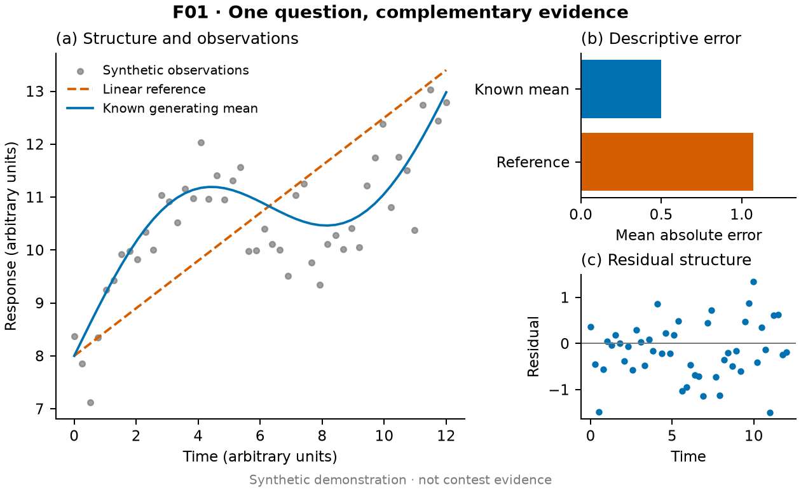

# Mathodology Modeling Skills

[简体中文](README.md) · **English**

Prompts and references for mathematical modeling contests: understand the problem,
formulate a model, challenge the result, and communicate the answer. Agents adapt
the work to the evidence and use specialists when their contribution helps.

## Desktop app: Mathodology Studio

[Mathodology Studio](apps/studio/README.md) is the companion open-source desktop
workbench. It drives the Claude Code, Codex or Gemini CLI already signed in on
your machine inside a contest project that carries these skills, with the
conversation, tool calls, approvals, task list, files, figures and paper preview
in one window. Figures, tables and code the agent writes are versioned with
their provenance, so any two versions can be compared or restored; a read-only
review checks each claim in the replies against the recorded tool calls,
outputs and files; a Literature panel finds papers through the search connector
and writes their BibTeX into the project; and connectors (MCP servers) are set
up once in Settings for all three agents. It calls no model API itself and
collects no data. Builds target macOS on Apple silicon and include onboarding
and settings.

## Scientific figures and image2

The [figure skill](.claude/skills/mathodology-figure-presets/SKILL.md) includes
[20 presets](.claude/skills/mathodology-figure-presets/references/presets.md): evidence
mosaics, forecast intervals, rainclouds, ridgelines, paired differences, forest plots,
joint distributions, clustered heatmaps, feasible regions, Pareto frontiers,
parallel coordinates, Sankey flows, networks, spatial insets, spatiotemporal plots,
sensitivity, calibration/residuals, survival, ablation and scenario robustness.

Each card explains inputs, layout, statistical meaning, pitfalls, simpler
alternatives, and plotting/caption prompts. The library also contains
[six paper figures and eight official code references](.claude/skills/mathodology-figure-presets/references/README.md)
with attribution and licenses, plus [six reproducible synthetic previews](.claude/skills/mathodology-figure-presets/examples/README.md).
The detailed recipe cards are in Chinese with English names; agents should adapt
their output to the paper's language.



At the first figure design, the agent asks whether image2 is available and how it
is accessed. An existing answer is reused and analysis continues while waiting.
image2 can assist illustrations, mechanisms and layouts; quantitative marks are
drawn from data and formulas. Figure work can finish without image2.

Without image2, default to the [20 callable chart code templates](.claude/skills/mathodology-figure-presets/templates/README.md): bind real data, execute the code and deliver PNG/PDF rather than waiting or returning only plotting instructions.

## Get started

Install skills for the chosen host in an existing project:

```bash
npx -y skills@latest add sweetcornna/mathodology --copy --yes --skill '*' --agent codex
```

For Claude Code, change the final argument to `claude-code`. The full checkout
also contains optional roles, workflow prompts and search MCP configuration;
a standard skills install does not install those project files automatically.
See [installation and updates](docs/INSTALL.md).

A starting prompt:

> Use mathodology-whole-project for this modeling problem. Read the question,
> data and constraints, establish an interpretable baseline, and test assumptions
> that could change the conclusion. Use mathodology-figure-presets for purposeful
> figures and ask once whether I have image2 when figure design begins. Keep
> evidence and calculations traceable, adapt the workflow to the task, and deliver
> the results, figures and actual limitations.

## A lightweight workflow

Retain mathematical correctness, traceable data, reproducible results and visual
inspection. There are no mandatory nine phases, formatted handoffs, figure quotas
or simulated prize scores. Specialists are optional; backup, repository checks,
PDF overviews and example rendering are small utilities used when needed.

The maintained source is `.claude/skills/`; `.agents/skills/` is an ignored local
mirror. This repository contains skills, docs, teaching references and the
Studio desktop app in `apps/studio/`, not contest datasets. Original content uses [MIT](LICENSE);
third-party material retains its own licenses.

[Skills](docs/SKILLS.md) · [Modeling prompts](docs/WORKFLOWS.md) · [Backup](docs/BACKUP.md)

[Default figure guidance for agents](.claude/skills/mathodology-figure-presets/references/figure-guidance.md)
