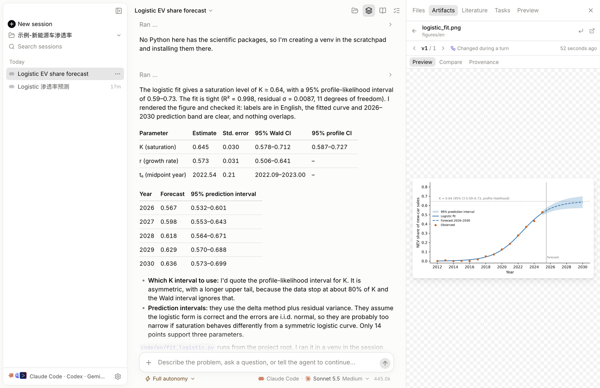
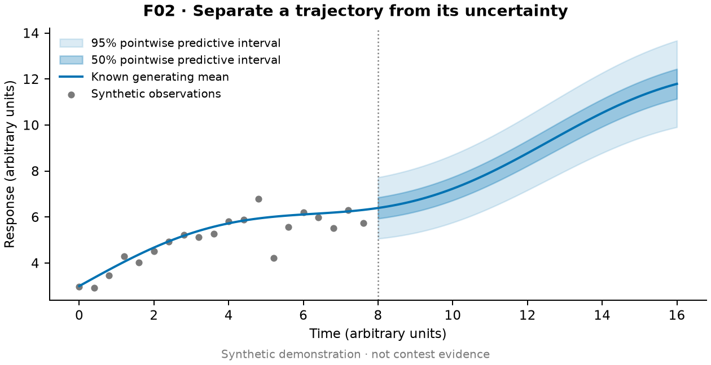
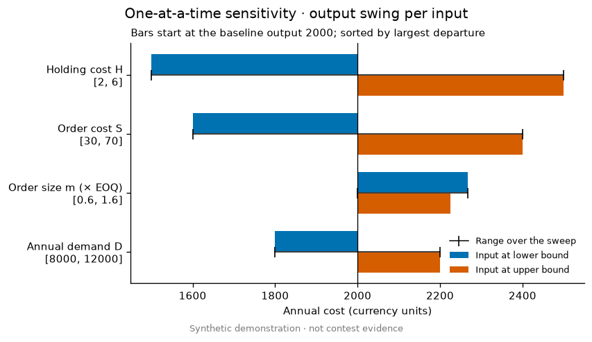
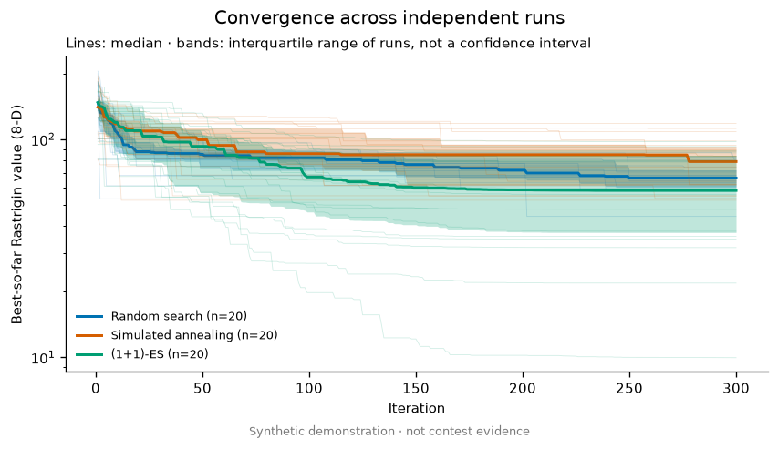
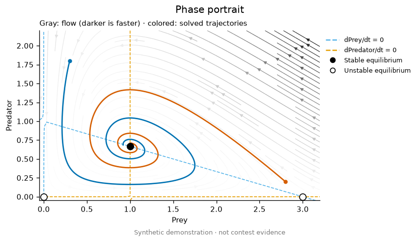
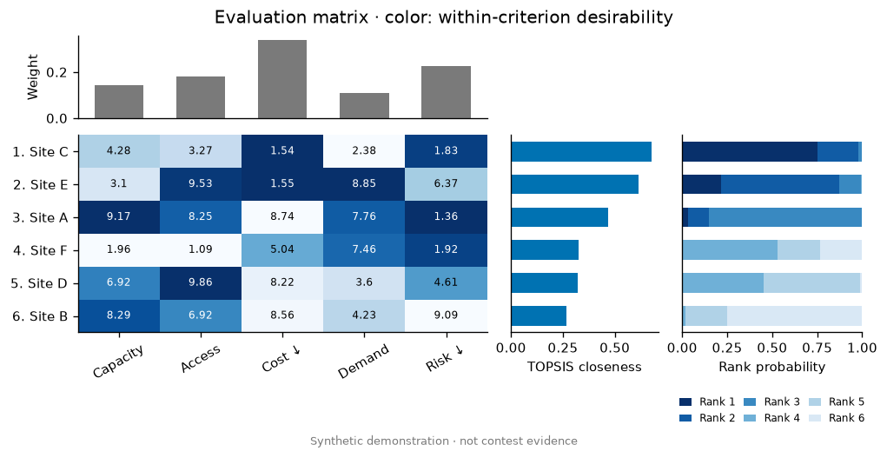
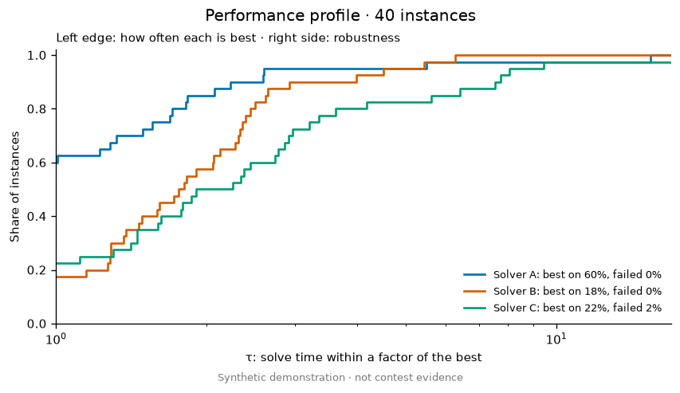

<p align="center">
  
</p>

<h1 align="center">Mathodology</h1>

<p align="center">
  Agent skills and a desktop workbench for mathematical modeling contests<br>
  <a href="README.md">简体中文</a> · <b>English</b>
</p>

<p align="center">
  <a href="https://github.com/sweetcornna/mathodology/releases/latest"></a>
  <a href="LICENSE"></a>
</p>



Mathodology teaches Claude Code, Codex and Gemini CLI to work like a modeling
team: understand the problem, build an interpretable model, test the conclusion
with experiments, draw figures that answer a question, cite only sources that
can be found, and write the paper clearly.

## What's inside

| | |
| --- | --- |
| **8 skills** | Modeling prompts, evidence search, scientific figures, review questions and more; see the [skill index](docs/SKILLS.md) |
| **8 specialist roles** | Lead, problem analyst, modeler, coder, evidence researcher, critic, paper editor, packager; used when they help |
| **46 figure templates** | Callable Matplotlib code: bind real data, get PNG/PDF |
| **18 experiment kits** | Sensitivity, Monte Carlo, backtests, ablations, rank stability and other standard experiments |
| **Citation checks** | `verify_refs.py` checks each DOI, title, author, year and retraction notice |
| **Studio desktop app** | One window for your local agents, with versioned outputs and traceable reviews |

## Figures and experiments

<table>
  <tr>
    <td width="33%"><br><sub>Forecast intervals</sub></td>
    <td width="33%"><br><sub>Tornado sensitivity</sub></td>
    <td width="33%"><br><sub>Convergence across runs</sub></td>
  </tr>
  <tr>
    <td><br><sub>Phase portrait</sub></td>
    <td><br><sub>Evaluation matrix</sub></td>
    <td><br><sub>Performance profile</sub></td>
  </tr>
</table>

The [20 base presets](.claude/skills/mathodology-figure-presets/references/presets.md) and
[26 advanced presets](.claude/skills/mathodology-figure-presets/references/presets-advanced.md)
each list data requirements, layout, misleading counterexamples, and plotting and
caption prompts. [Experiment kits](.claude/skills/mathodology-figure-presets/references/experiments.md)
call your model and return arrays that feed the matching figure and a three-line
table. All previews use synthetic data; see the
[gallery](.claude/skills/mathodology-figure-presets/examples/README.md). The recipe
cards are in Chinese with English names.

At the first figure, the agent asks once whether image2 is available. Work
finishes without it: quantitative figures are always drawn from data and code.

## Mathodology Studio

[Studio](apps/studio/README.md) is an open-source desktop workbench for macOS,
Windows and Linux. It calls no model API, stores no keys and collects no data.

- Drives the Claude Code, Codex or Gemini CLI signed in on your machine; switch between turns
- Every change to a figure, table or code file becomes a version you can compare, restore and trace to its turn
- Read-only review checks each claim against the tool record; citations are traced, and DOIs the DOI system does not know are flagged as likely made up
- The Literature pane finds papers, checks the DOI before writing `references.bib`, and checks a whole bibliography entry by entry
- Installs [humanizer](https://github.com/blader/humanizer) to take the AI tone out of the prose, and updates it at each launch
- MCP connectors are set up once in Settings for all three agents; the built-in free-search-mcp updates to its newest release at each launch

**Download v0.17.0:** [macOS DMG](https://github.com/sweetcornna/mathodology/releases/download/v0.17.0/Mathodology-Studio-0.17.0-arm64.dmg) (Apple silicon) ·
[Windows installer](https://github.com/sweetcornna/mathodology/releases/download/v0.17.0/Mathodology-Studio-0.17.0-x64-setup.exe) (x64) ·
[Linux .deb / AppImage](https://github.com/sweetcornna/mathodology/releases/tag/v0.17.0) (x64, arm64).
The app is unsigned. On macOS, Control-click it in Finder and choose Open the
first time; on Windows, choose More info → Run anyway if SmartScreen appears.
On Ubuntu 23.10 and later use the .deb: AppImages cannot use Chromium's sandbox
there. At least one agent CLI must be installed and signed in.

Or run from source (Node.js 22.12+, pnpm 10):

```bash
cd apps/studio && pnpm install && pnpm dev
```

## Get started

Install the skills in an existing project (for Claude Code, change the last
argument to `claude-code`):

```bash
npx -y skills@latest add sweetcornna/mathodology --copy --yes --skill '*' --agent codex
```

Then tell the agent:

> Use mathodology-whole-project for this modeling problem. Read the question,
> data and constraints, establish an interpretable baseline, and test assumptions
> that could change the conclusion. Use mathodology-figure-presets for purposeful
> figures. Keep calculations and sources traceable, and deliver the results,
> figures and actual limitations.

The full checkout also carries roles, workflow prompts and the search MCP
configuration; see [installation and updates](docs/INSTALL.md).

## Docs

[Skills](docs/SKILLS.md) · [Modeling prompts](docs/WORKFLOWS.md) · [Install](docs/INSTALL.md) ·
[Backup](docs/BACKUP.md) · [Studio](apps/studio/README.md) ·
[Figure guidance for agents](.claude/skills/mathodology-figure-presets/references/figure-guidance.md)

The maintained source is `.claude/skills/`; `.agents/skills/` is an ignored local
mirror. The repository holds no contest datasets. Original content is
[MIT](LICENSE)-licensed; third-party material keeps its own license.
